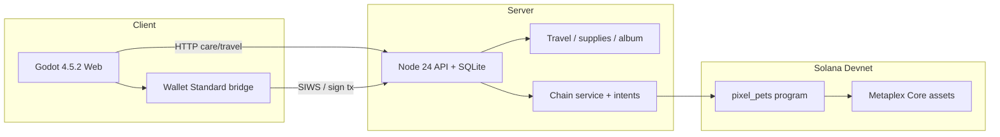

# PixelPets · 掌心伙伴

**A tiny companion. A world of stories. Collect the journey.**  
会替你出门的像素伙伴，以及可以交换的旅途收藏。

Free-to-play pixel companions (Moss / Puddle / Wisp): adopt and care without a wallet, send them on short trips for postcards & keepsakes, then optionally claim a **Solana Devnet** Metaplex Core identity and save a verifiable journey receipt.

> **Honest status (2026-10-10):** travel loop + Devnet program/collection/editions are live; scripted Wallet Standard claim → trip → receipt → gift PASS. **Public HTTPS** and **real Phantom/Backpack** QA still need Wes. No project token.

Draft PR: https://github.com/weswes233/PixelPets/pull/1 · Product preview: [docs/plan/PRODUCT-PREVIEW.md](docs/plan/PRODUCT-PREVIEW.md) · Evidence: [docs/evidence/devnet-demo-2026-10-10.json](docs/evidence/devnet-demo-2026-10-10.json)

---

## Why play / 为什么玩

| English | 中文 |
| --- | --- |
| Cute original pixel pets with stable personalities | 原创像素伙伴，性格稳定可读 |
| Prepare → wait → postcard surprise (Travel Frog energy, without cash gambling) | 准备 → 等待 → 明信片惊喜（旅行青蛙式期待，不做真钱赌） |
| Keepsakes are collection records, not tokens | 纪念物是收藏记录，不是代币 |
| Optional on-chain identity + journey receipt you can open on Explorer | 可选链上身份 + 可在 Explorer 核验的旅程收据 |
| Gift a companion; the new owner continues care | 赠送后新主人可继续照顾 |

---

## Key features done / 已完成要点

- **Care loop:** feed / play / rest / short walk; bond → sun/moon forms (3 species × 3 forms).
- **Travel (server-authoritative):** 2 routes, packing items, free supplies (3/day UTC), demo timer labelled in UI (default 45s; recording used 10s).
- **Postcard + keepsakes + Album** (8 collectibles as server records, not NFTs).
- **Solana Devnet:** Metaplex Core collection + 3 editions; claim; checkpoint **v2** journey receipt; two-wallet gift (scripted).
- **Wallet Standard** bridge (SIWS, review dialog, register / receipt / gift).
- **Restart recovery** (localnet evidence): mid-trip SIGKILL keeps `ready_at`; unsigned receipt intent survives restart.
- **Bilingual UI** (English-first) + 120-codex silhouette browser (concepts only).

**Not done / 未完成:** public HTTPS full stack; real extension-wallet popup QA; shop checkout; project token (intentionally none).

---

## Architecture / 架构



| Layer | Role |
| --- | --- |
| Godot client | Pixel art, care UI, travel planner/postcard, album |
| TypeScript server | Authoritative care, CSPRNG travel results, supplies ledger, session auth |
| Anchor program + Core | Limited editions, claim co-sign, PetRecord checkpoint hashes, gift/transfer |
| Wallet bridge | Wallet Standard connect, SIWS, reviewed transactions |

Feeding is **not** on-chain every time. Chain is for **identity, receipts, and ownership**.

---

## Devnet links / Devnet 链接

| Item | Link |
| --- | --- |
| Program `2SCKfWsz…Qm2nT` | https://explorer.solana.com/address/2SCKfWszFZuqsjcmRbtmctHwZTgQopYmGSofoEtQm2nT?cluster=devnet |
| Collection `5BnUfTQ…cuoiS` | https://explorer.solana.com/address/5BnUfTQ249v4v7sVAuohBEstsWF9JdzmaHwSbK7cuoiS?cluster=devnet |
| Sample claim tx | https://explorer.solana.com/tx/5RX2AWhvE3g1iWQZ8XxusRZExdbew9VqhVG4ivMMS6NwaUgEmbTzdXj63Jtiz67SSMBMuPAz677shUHz77pu7NcT?cluster=devnet |
| Sample journey receipt tx | https://explorer.solana.com/tx/2WtTemMxoS1jSFmQ6by5BE3jBmXNWdFsmezTEMqzuPS7qrPknbsCnu9WB5i2FTsjdvDcki8nbrANdGocYKZC5mix?cluster=devnet |
| Public proof id | `jr_eIE4lv-XhPMvy0bgFLcUTw` (independent verifier 10/10 in evidence) |
| Gift tx (scripted) | https://explorer.solana.com/tx/5ZNrPvAMSG7GxoXTQMTZc7AnerHSG4Ca5p9eXoTZHE9wBFnqbVFYpUWxFB4NtT3g7PxdZApvRUGXsW9XqHEe9UW2?cluster=devnet |

Program id replaces the old declare_id key (not on this machine). **Wes must approve** before merge/mainnet. Editions: moss=1001, puddle=1002, wisp=1003.

---

## How to run locally / 本机运行

### Linux / macOS (box)

```bash
export PATH="$HOME/.grok/bin:$HOME/.cargo/bin:$HOME/.local/share/solana/install/active_release/bin:$HOME/.local/node/bin:$PATH"
npm ci --ignore-scripts
# Web export must already exist in dist/web (or build with Godot 4.5.2 + tools/build.ps1)
./tools/demo-up.sh local          # http://127.0.0.1:9783/
# With Devnet chain (needs runtime/devnet-chain.env + issuer key; optional Helius override):
CHAIN_ENV=runtime/devnet-chain.env TRAVEL_DURATION_MS=45000 ./tools/demo-up.sh local
./tools/demo-up.sh stop
```

### Windows

```powershell
# Care-only (no CHAIN_*):
.\tools\start.ps1 -OpenBrowser
# Devnet travel stack (loads runtime\devnet-chain.env + helius.local.env):
powershell -ExecutionPolicy Bypass -File tools\start-devnet.ps1 -OpenBrowser
# Or double-click 开始游玩.cmd for the simple local start
.\tools\stop.ps1
```

See [docs/plan/windows-play.md](docs/plan/windows-play.md). Save file: `runtime/pets.sqlite` (do not delete to “restart” casually). Demo DB: `PIXELPETS_DB=runtime/demo/pets-demo-devnet.sqlite`.

**RPC note:** on some CN networks `api.devnet.solana.com` is hijacked; `start-devnet.ps1` prefers Helius server-side and a keyless public RPC for the browser. On this Linux box, public Devnet RPC is fine.

---

## Tests / 测试

```bash
npm test                          # JS unit tests
npm run typecheck:server && npm run typecheck:sdk && npm run typecheck:wallet
# Godot (needs Godot 4.5.2 on PATH):
# godot --headless --path game --script tests/client_test.gd -- --client-test
node chain/tests/devnet-stack-smoke.mjs   # Devnet claim→trip→receipt (scripted keys)
node chain/tests/gift-two-wallet-devnet.mjs
```

Checklist: [docs/plan/00-today-checklist.md](docs/plan/00-today-checklist.md).

---

## No-token rationale / 为什么不发币

Issuing a tradeable token does **not** create demand, a prize pool, or retention. Day-one economy uses **non-redeemable free supplies** and collectible keepsakes with **no cash value**. Future paid paths (if any) should be **fixed cosmetic / theme packs** and later peer trades with clear value — not “bring cash, maybe win more cash.” Full analysis: [docs/plan/01-product-and-economy.md](docs/plan/01-product-and-economy.md) §7–8.

---

## Roadmap / 路线图

| Stage | Focus |
| --- | --- |
| Now | Wes: approve program id, Phantom claim+receipt, public HTTPS host |
| Next | More routes/stories, keepsake exchange intent, polish EN/ZH |
| Later | Fixed-price cosmetics, mainnet only after security + legal review |
| Explicitly out | Project token, cash random-return travel, VRF prize vaults, 120 finished art in one day |

---

## Important caveats / 重要边界

- Devnet assets have **no cash value** and are not a mainnet promise.
- Travel RNG is **server-side** (labelled); the on-chain receipt hashes the settled result, it does not prove VRF fairness.
- Metadata URIs are immutable `ipfs://…`; Lighthouse/Irys hold matching bytes; public ipfs gateways may challenge bots.
- Issuer co-signs claims; program is upgradeable — trust boundary disclosed.
- Scripted Wallet Standard tests ≠ extension popup / mobile deep-link QA.

---

## Team / 团队

**Wes** ([weswes233](https://github.com/weswes233)) — product & repo owner. Built with Grok agents on the one-day travel/Devnet track.

Submission pack: [docs/submission/SUBMISSION.md](docs/submission/SUBMISSION.md) · Pitch: [docs/submission/PITCH.md](docs/submission/PITCH.md)
