# PixelPets 产品长什么样（预览）

分支：`feature/travel-devnet-demo` · 草稿 PR：[weswes233/PixelPets#1](https://github.com/weswes233/PixelPets/pull/1)

**一句话：** 会替你出门的像素伙伴，以及可以交换的旅途收藏。  
免费照顾三只原创宠物（苔苔 Moss / 啵啵 Puddle / 微光 Wisp），出游带回故事和纪念物；可选在 Solana Devnet 领取链上身份，并把旅途结果存证到 checkpoint v2。

> 下面截图来自本机演示（英文主流程 + 中文切换）。脚本钱包 Devnet 领取/旅行/赠送已通。
>
> **公网演示：** [https://175.178.27.231/](https://175.178.27.231/)（自签证书，浏览器点「继续访问」；Phantom 切 Devnet）。真实 Phantom 弹窗验收见 [wes-verify.md](wes-verify.md)；部署说明 [cloud-deploy-2026-10-10.md](cloud-deploy-2026-10-10.md)。

## 主流程截图

### 出发旅行
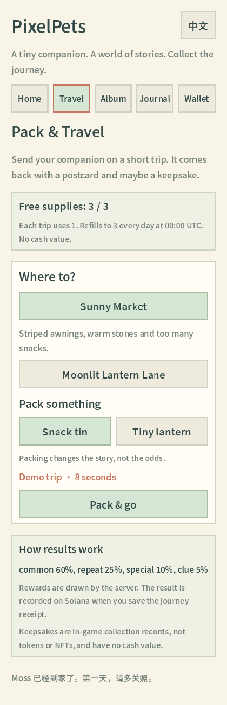

### 旅途中
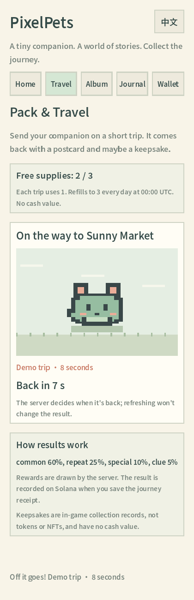

### 归来
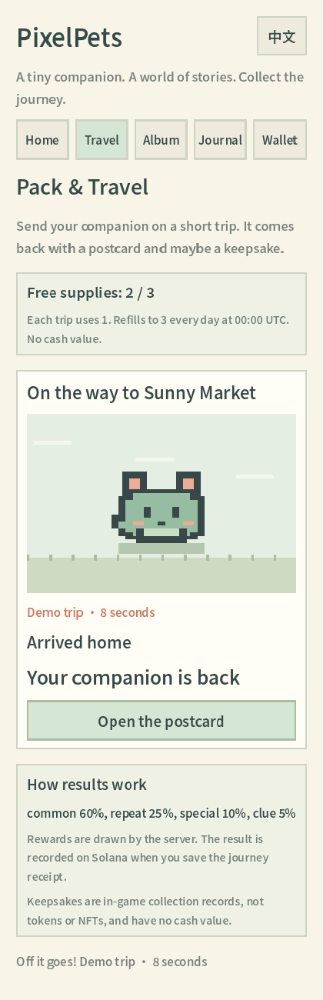

### 明信片 / 收藏结果
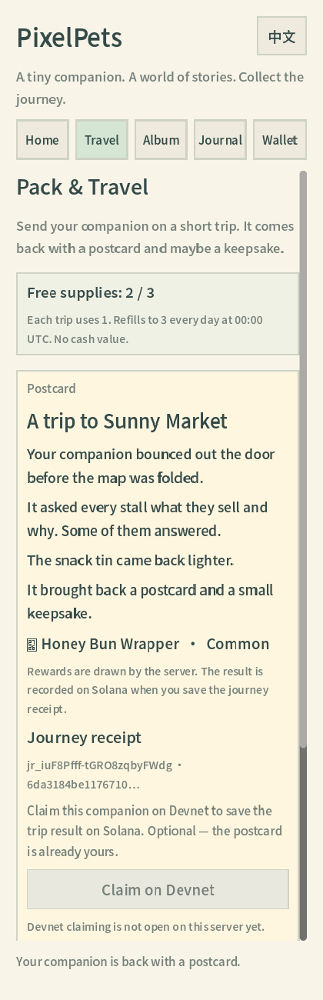

### 刷新后仍在
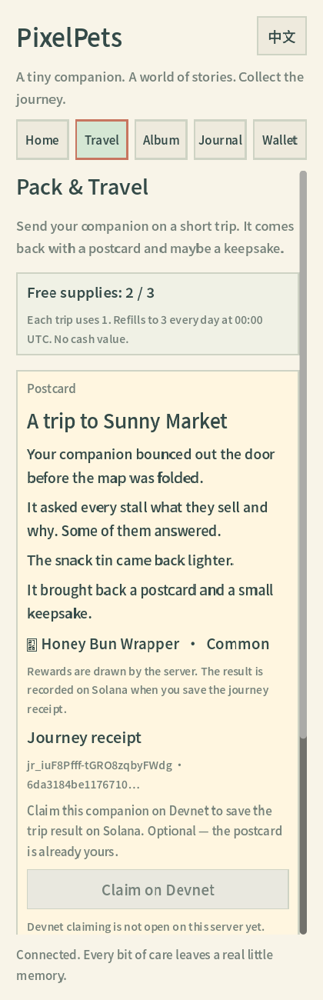

### 钱包页
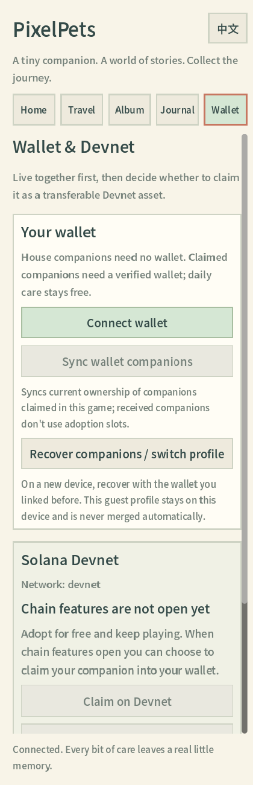

### 图鉴 / 卡册
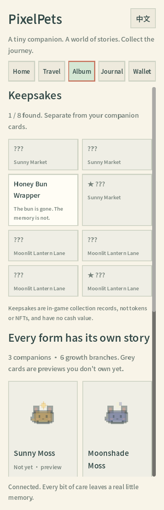

### 中文切换
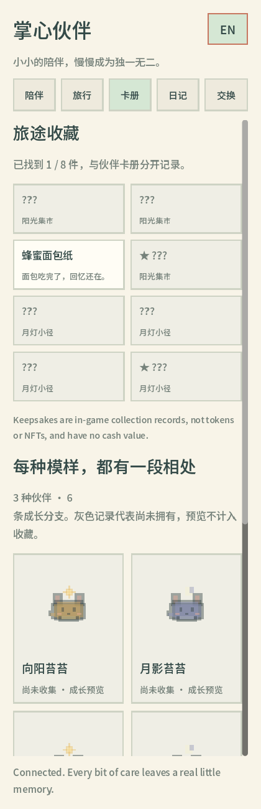

### 领取前 / 审阅 / 领取后（脚本钱包）
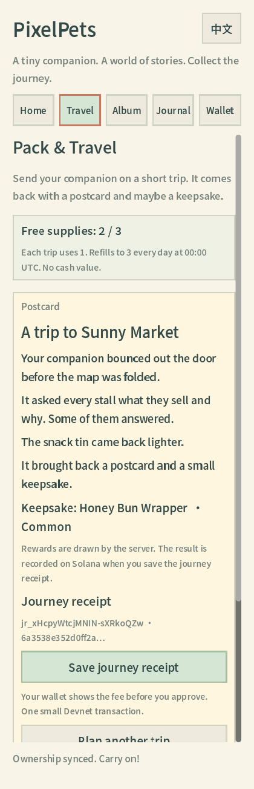
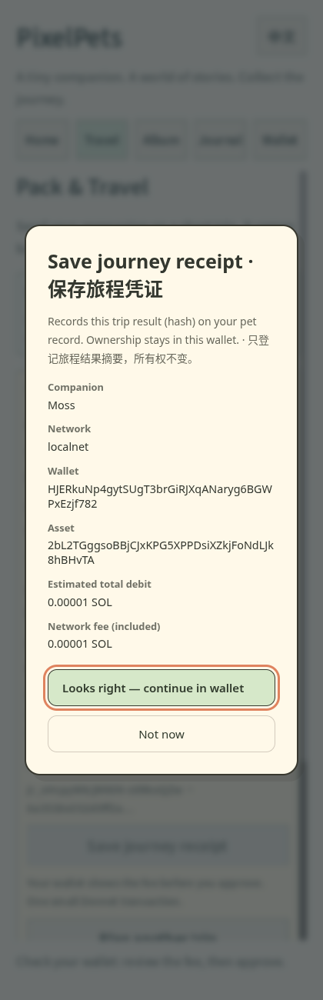
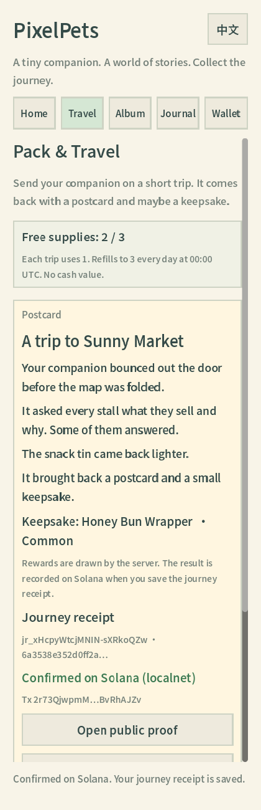

## Devnet（已部署）

| 项 | 链接 |
| --- | --- |
| 程序 | https://explorer.solana.com/address/2SCKfWszFZuqsjcmRbtmctHwZTgQopYmGSofoEtQm2nT?cluster=devnet |
| 集合 | https://explorer.solana.com/address/5BnUfTQ249v4v7sVAuohBEstsWF9JdzmaHwSbK7cuoiS?cluster=devnet |
| 证据 JSON | [devnet-demo-2026-10-10.json](../evidence/devnet-demo-2026-10-10.json) |
| 双钱包赠送 | [gift-two-wallet-devnet.json](../../chain/evidence/gift-two-wallet-devnet.json) |

## 本机怎么打开（开始游玩）

1. **Windows：** 双击仓库里的 `开始游玩.cmd`（内部会起本机服务并打开浏览器）。  
2. **Linux / 本盒：** `./tools/demo-up.sh local` → 打开 http://127.0.0.1:9783/  
3. 链关闭时也能先玩养成与旅行；连 Devnet 需要钱包，并存在 `runtime/devnet-chain.env`（由 `tools/devnet-deploy.ts --execute` 生成，已 gitignore）。

## 静态预览 / GitHub Pages（拆分说明）

- Godot Web 导出在 `dist/web/`（约 45 MB，`dist/` 已 gitignore，未推进仓库以免撑爆 PR）。  
- **可以**把 `dist/web/` 单独丢到 GitHub Pages / Cloudflare Pages 做静态壳；**API（养成/旅行权威）仍要一台可达主机**。本盒隧道出站被封，全栈公网 HTTPS 尚未就绪——不要把「只有静态页」当成完整演示。  
- 现在最快看清产品：打开本页截图 + 本机 `demo-up.sh local`。

## 还差什么

- 公网 HTTPS 全栈演示站（需主机/域名或你登录 Cloudflare）。  
- 你用 Phantom/Backpack 亲手点一遍领取、凭证、赠送（脚本已通）。  
- （可选）Pinata/Filebase 控制台二次 pin，方便你在仪表盘里看到 CID。
