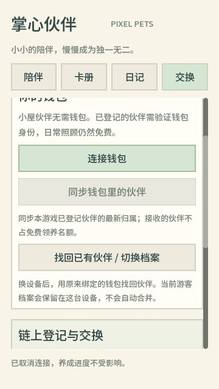

# 钱包恢复、归属同步与发布基础验收

日期：2026-10-09。项目：PixelPets / 掌心伙伴。

本轮把钱包恢复、宠物转手后的档案归属和日常养成接进实际客户端，并补齐本地存档、数据库备份和公开免费试玩的部署模板。像素宠物与场景仍由 Godot 代码绘制。

## 玩家现在能做什么

1. **换设备找回伙伴。** 在交换页选择「找回已有伙伴 / 切换档案」，使用原来绑定的钱包签署登录消息。恢复的是原账户；当前游客档案保留在本机，不会被合并或删除。
2. **切回上一份本机档案。** 本机保存多份独立档案凭据。切换时清空旧宠物、日记、报价和待确认操作，延迟返回的旧请求不能改写新画面。
3. **接收别人转来的伙伴。** 同步本游戏已登记宠物的实际链上持有人，转入后建立新的养成关系。旧昵称、私人日记和未上链的亲密度不会复制给接收者；已确认的链上成长保留。
4. **继续免费照顾链上伙伴。** 已登记伙伴需连接并验证当前持有钱包；之后照顾、改名使用登录会话，不会每次签交易。领取链上资产、保存成长到链上仍需逐笔交易确认及网络费用。
5. **得到明确的受限状态。** 转出后旧主人不能继续修改；市场托管中只读；网络故障或归属无法确认时停止修改已登记伙伴，未登记伙伴仍可玩。

免费领养上限仍是 3 只。接收的链上伙伴不占免费名额；把自己领养的伙伴上链或放进托管，不会凭空增加免费名额。

## 工程变更

- 独立的钱包恢复 challenge 与验签接口，校验 domain、network、purpose、nonce 和 5 分钟有效期。未验签查询不泄露钱包是否已有账户；没有绑定过的钱包不会被恢复接口自动创建账户。
- 恢复后的游戏凭据有效 30 天，钱包会话有效 24 小时；游戏凭据不能访问钱包与链操作特权接口。多设备会话共存，断开只撤销当前钱包会话。
- 已登记资产在每次修改前进行 finalized 归属核验。跨进程租约保护归属同步，异步链操作在写入前检查租约，旧请求失去租约后不能落库。
- 本机凭据先写临时文件并重新读取核对，替换成功后才更新内存。写入、校验或替换失败都保留原档案。恢复结果无法保存时，客户端不会假装切换成功。
- 在线 SQLite 备份包含已提交的 WAL，验证完整性和外键，不覆盖已有目标；恢复写入新路径。2026-10-09 已在更新现有服务前备份实际数据库，迁移后原有 3 只宠物、9 条日记及 21 个事件均保留。
- 来源限流默认使用连接地址，仅允许明确配置的可信代理覆盖专用地址头。13 个独立代理访客和伪造来源的实际 HTTP 检查通过。
- 新增轻量存活检查；公开试玩模板采用 Caddy HTTPS、Node24、单实例持久 SQLite。构建脚本检查 Godot 与 release 模板确实为 4.5.2，按所选平台校验；不再要求无用的 debug 模板。
- 网页设置中文语言、允许缩放，启用 Godot 实验性虚拟键盘。实际浏览器已检查 360×640 画布、恢复说明、无钱包提示与取消；仍不等同于手机真机验收。

## 本轮验证

| 项目 | 结果 | 说明 |
| --- | --- | --- |
| JavaScript 自动化测试 | 136/136 | SDK、钱包、服务器、备份、归属、HTTP、恢复与代理 |
| TypeScript | 3 套通过 | server / wallet-web / chain-client |
| Godot 客户端 | 49/49 | 页面尺寸、档案切换、旧请求隔离、归属状态、确认响应 |
| Godot 本机存储 | 26/26 | 独立测试目录，正常保存、恢复、读回、失败保留 |
| Godot 实际 HTTP | 11/11 | 临时端口和内存数据库，不改玩家存档 |
| 真实本地领取 / 成长 | 5 项、3 笔交易 | HTTP 与 SQLite 重启后继续同一签名，成长实际写链 |
| 真实本地转手 / 恢复 | 6 项、3 笔交易 | Core 实际转移，旧主人失权，接收方找回与继续养成 |
| 发布产物 | Web、Windows 导出完成 | 当前本地游戏已更新 |

可机读清单见 [acceptance-2026-10-09.json](acceptance-2026-10-09.json)。真实链证据见 [领取与成长](../chain/evidence/service-e2e.json)、[转手与恢复](../chain/evidence/ownership-service-e2e.json)。历史 16 项合约/市场检查、36 笔交易未在本轮再次执行，原证据继续保留。

真实链检查曾遇到 Clock 与 RPC context 不一致，服务按预期拒绝该数据。现已加入整份丢弃、最多三次重新读取的处理，持久不一致仍然失败；回归测试证明错误快照不会触发转移或写入。上游 [Agave 问题记录](https://github.com/anza-xyz/agave/issues/4807) 说明 RPC context 不能当作原子快照保证。相关失败证据也保留，最终通过不代表不存在底层 RPC 一致性风险。

## 尚未完成的发布条件

- 当前日常预览仍为本地服务，链上登记默认关闭。未部署 Devnet 或主网，也没有公共试玩网址。
- 本地链使用一次性脚本钱包和无经济价值的测试币；浏览器真实钱包扩展、手机钱包回跳与签名弹窗仍需验收。
- Docker/Caddy 在此机器不可用，模板尚未完成容器构建、正式域名/证书或公网压缩缓存验收。
- 归属同步只发现本服务登记的资产，上限 128 只；公开扩容前应接入分页索引与后台同步，不能称为任意 NFT 钱包导入。
- 当前是最终状态轮询，不是完整转移历史。未观察到的 A→B→A 往返无法被现有状态证明；批量 RPC 核验也不能保证不存在读后转移。
- 本机文件写入测试证明原文件的替换与回滚；Web 虚拟文件写入成功不独立证明所有浏览器 IndexedDB 的持久保存。手机、隐私模式和存储限额仍需验证。
- 游戏内上架、购买、交换和赠送界面尚未开放；英文、AI 表达、硬件展示仍为后续工作。

## 下一阶段顺序

先把免费试玩部署到稳定 HTTPS 环境并验证恢复和备份；随后准备真实可访问的像素资产元数据并发布 Devnet；接着补齐两钱包赠送、上架与成交的完整游戏界面。交易验收通过后，再验证真实用户是否愿意为具体收藏和表达需求付费，而不是以价格上涨或收益承诺代替消费需求。

